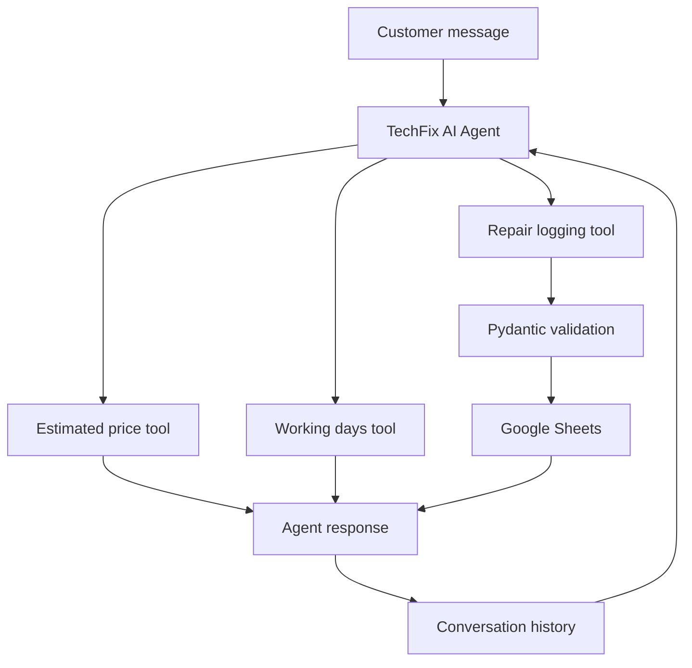

# Day 4 – TechFix Electronics Repair Center AI Agent

## Project Overview

Day 4 extends the TechFix customer support chatbot into a tool-enabled AI agent that estimates repair costs, checks working days, validates customer details, and records confirmed repair requests in Google Sheets.

## Technologies Used

- Python and Google Colab
- LangChain and ChatGroq
- Groq API – `openai/gpt-oss-20b`
- Pydantic for data validation
- gspread and Google authentication for Google Sheets

## Business Rules

- TechFix repairs smartphones and laptops.
- Services include screen replacement, battery replacement, and software troubleshooting.
- The center operates Monday through Saturday.
- Device diagnosis is required before repair.
- Final repair costs depend on device condition; completion times are not guaranteed.
- Repair requests are saved only after customer confirmation. A preferred visit date is not a confirmed appointment.

## Setup and Execution

### Cell 1 – Installation and Configuration

```python
!pip install -q langchain langchain-groq gspread
```

Add the Groq API key to Colab Secrets as `GROK_API_KEY` and enable notebook access.

```python
import os
from google.colab import userdata, auth
from langchain_groq import ChatGroq

os.environ['GROQ_API_KEY'] = userdata.get('GROK_API_KEY')
llm = ChatGroq(model='openai/gpt-oss-20b', temperature=0.2, max_retries=3)
```

Authenticate with Google using `auth.authenticate_user()`, authorize gspread using Google credentials, and create a spreadsheet named **TechFix Repair Requests**. Use the existing spreadsheet on subsequent runs to avoid duplicates.

### Cell 2 – Business Data and Validation

The `SERVICES` dictionary contains sample estimates for development and testing:

| Service | Estimated price (INR) |
| --- | ---: |
| Screen replacement | 1500 |
| Battery replacement | 1000 |
| Software troubleshooting | 500 |

These are demonstration estimates, not confirmed repair prices.

The `HOURS` dictionary records open and closed days. The Pydantic `RepairRequest` model validates customer name, device type, service, quantity (minimum one), preferred visit date, and reported problem.

### Cell 3 – Agent Tools

| Tool | Purpose |
| --- | --- |
| `get_estimated_price(service, qty)` | Calculates an estimated repair cost using the service dictionary. |
| `is_open(day)` | Checks whether TechFix is open on the requested weekday. |
| `log_repair(name, device, service, qty, date, problem)` | Validates a confirmed request and appends it to Google Sheets. |

The functions use LangChain's `@tool` decorator to make them available to the agent.

### Cell 4 – Agent Creation and Conversation Memory

```python
from langchain.agents import create_agent

agent = create_agent(
    model=llm,
    tools=[get_estimated_price, is_open, log_repair],
    system_prompt=SYSTEM
)
```

The system prompt defines business rules, tool selection instructions, confirmation requirements, and friendly English or Telugu responses under 60 words. The `chat()` function invokes the agent with conversation history, stores returned messages, and handles exceptions with a friendly retry message.

## System Architecture



## Google Sheets Integration

The spreadsheet stores the following columns:

`name`, `device`, `service`, `qty`, `date`, `problem`, `estimated_total`

A successful logging operation records the request and its estimated total.

## Example Testing

| Customer question | Expected behavior |
| --- | --- |
| Are you open on Sunday? | Reports that TechFix is closed. |
| How much for two screen replacements? | Returns an estimated INR 3000, subject to diagnosis. |
| I'm Ravi. Both my smartphones have broken screens. I want two screen replacements on 24 Dec. Please save my repair request. | Validates the details and saves the confirmed request if Google Sheets is connected. |
| What is my name and repair request? | Recalls the customer and request from conversation history. |

These are expected behaviors, not recorded live test results.

## Learning Outcomes

- Creating a LangChain agent with callable tools.
- Using Python functions for deterministic business calculations.
- Validating structured customer data with Pydantic.
- Connecting an AI agent to Google Sheets.
- Maintaining conversation context across messages.
- Applying business rules and confirmation requirements before recording requests.

## Conclusion

Day 4 demonstrates the transition from a conversational chatbot to a tool-enabled AI agent that can perform practical business tasks for TechFix Electronics Repair Center.
